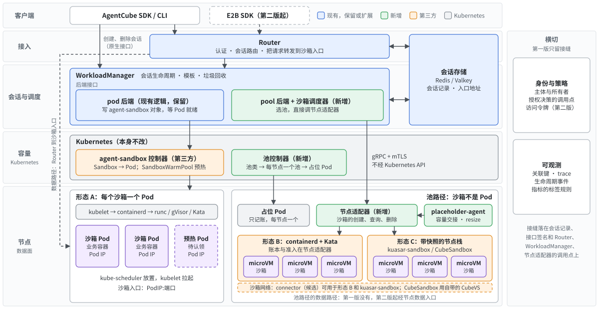
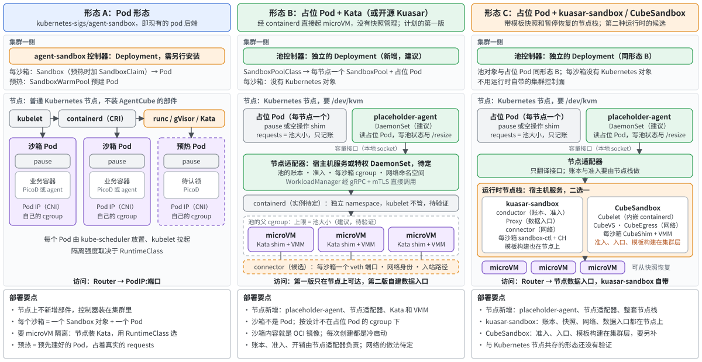

<!--
style: |
  section { font-size: 18px; padding: 22px 40px 34px; place-content: safe start; }
  h2 { font-size: 26px; margin: 0 0 8px; }
  section img { display: block; width: 1170px; margin: 0 auto; }
  footer { font-size: 11px; }
  section.compare table { font-size: 12.2px; line-height: 1.3; }
  section.compare th, section.compare td { padding: 3px 7px; }
  section.compare th:first-child { width: 86px; }
  section.notes { font-size: 13.5px; line-height: 1.42; }
  section.notes ol { margin: 4px 0; padding-left: 22px; }
  section.notes li { margin: 2px 0; }
  section.notes p { margin: 4px 0; }
-->

## 1. 整体架构：控制面共用，数据面在后端接口处分叉

---

## 2. 三种数据面形态怎样部署

---

<!-- _class: compare -->

## 3. 三种形态的比较

| 方面 | 形态 A：Pod（agent-sandbox） 现有的 `pod` 后端，保留 | 形态 B：占位 Pod + Kata（或开源 Kuasar ⁹） 计划的第一版 | 形态 C：占位 Pod + kuasar-sandbox / CubeSandbox 带快照的第二种运行时的候选，第四版之前接入 |
|---|---|---|---|
| Kubernetes 对象与原生能力 | 每沙箱一个 `Sandbox` 和一个 Pod（预热时加 `SandboxClaim`）；kubectl、配额、NetworkPolicy、PVC、驱逐都作用得到 | 没有逐沙箱的对象，这些机制作用不到沙箱；每节点一个 `SandboxPool` 和一个占位 Pod | 同形态 B |
| 发放路径 | API server → agent-sandbox 控制器 → 调度器 → kubelet → 容器运行时 | 沙箱调度器 → 节点适配器 → containerd → Kata → VMM，不经 Kubernetes API | 沙箱调度器 → 节点适配器 → 节点栈的私有接口 → VMM，不经 Kubernetes API |
| 发放性能 | 冷：一次完整的 Pod 启动。热：认领预热 Pod，至少 4 次 API 写入。上游自述：突发约 300 次/秒、p90 ≤ 200 ms；边补池时单池上限约 70 至 85 个/秒；持续 30 次/秒以上控制面可能成为瓶颈 ¹ | 每次都冷启动一台 microVM。这条路径还没有数字，由 000-5 实测；Kata 文档里的参考值是冷启动 1.16 秒（Dragonball）、0.82 秒（QEMU）² | 可从模板快照恢复，这是 CubeSandbox 的常规路径。它的完整栈自述创建均值 41 ms（并发 1）、92 ms（并发 50）；kuasar-sandbox 不发布启动时延的绝对值 ³ |
| 预热管理 | `SandboxWarmPool` 预建完整的 Pod，占着真实的 requests；认领后不回池，由控制器补足 | 没有。占位 Pod 预留的是资源，不是虚拟机；镜像预置还是按需拉取待定 | 模板快照都在节点上恢复；模板构建：kuasar-sandbox 在节点上，CubeSandbox 在集群层。都没发现预启动的虚拟机池 ⁴ |
| 快照与暂停恢复 | 只有 `Suspended`：删 Pod、留卷，不保留内存 ⁵ | 没有，第一阶段放弃 | 有：暂停是存快照后退出虚拟机，可恢复；流量唤醒在 kuasar-sandbox 由节点触发，在 CubeSandbox 由集群层触发；后者另有回滚和 fork ⁶ |
| 网络 | Pod 网络：CNI 分配 Pod IP，Router 直连 `PodIP:端口`，NetworkPolicy 可用 | 节点适配器为沙箱准备网络命名空间，做法由 000-5 定；没有数据入口和出站策略，第二版自建入口 | 都自带 TAP 加 eBPF 的节点网络。kuasar-sandbox：入口在节点上，出站靠外部网关；CubeSandbox：入口在集群层，出站策略自带 ⁶ |
| 记账与准入 | kube-scheduler 按每个 Pod 的 requests 放置 | 占位 Pod 向调度器记账；池内由节点适配器的账本同步准入。不超分、父 cgroup 兜底是建议，后者待验证 | 池内的账本和最终准入归运行时：kuasar-sandbox 的拒绝是异步的，CubeSandbox 的节点层没找到容量比较 ⁷ |
| 池容量调整 | 没有容量池；预热池的大小改 `SandboxWarmPool` 的副本数 | 占位 Pod 原地 resize（最低版本拟定 Kubernetes 1.35，未确认），节点一侧改账本上的数字；手工调整在第一版 | 同形态 B，另加节点一侧：kuasar-sandbox 要重启 conductor；CubeSandbox 配额可热加载，约束力未核实 |
| 每沙箱开销 | 一个完整的 Pod，用 Kata 时另加虚拟机的开销；没有读到数字 | 默认规格 1 vCPU、2048 MiB 是上限，不预分配；Kata 文档自述每台平均占 223 MiB（QEMU，busybox）；固定开销由 000-5 实测 ² | CubeSandbox 自述 2000 MiB 规格的沙箱每台摊销宿主内存 18.7 至 24.6 MiB；kuasar-sandbox 没有读到数字 ³ |
| 隔离与节点前提 | 隔离取决于 RuntimeClass（runc、gVisor、Kata）；普通节点即可 | 每沙箱一台 Kata microVM，内容即 OCI 镜像；节点要 `/dev/kvm`，装 Kata、VMM、`placeholder-agent`、节点适配器 | 每沙箱一台 microVM，镜像要先做成模板；节点要 KVM，装整套节点栈；占位 Pod 一侧的前提同形态 B ⁸ |
| 主要代价 | 逐沙箱的对象与调度开销；预热占真实资源；没有内存快照 | 冷启动；账本、准入、网络都自己做；requests 只是记账，节点压力下的行为没验证；要快照得接第二种运行时或等 Kata 上游 | 节点栈重；与 Kubernetes 节点共存的形态和节点压力下的行为都没有验证；CubeSandbox 还要补它集群层的那几样 |

---

<!-- _class: notes -->

## 附：口径与出处

全部来自静态阅读（源码、文档、设计提案），没有部署，也没有实测。标“自述”的数字出自项目自己的文档，没有复现，测试条件互不相同，不能直接横向比较。没有另注出处的结论读自下面这些版本的源码和文档。编号对应比较表里的上标。

读的版本：agent-sandbox `main` @ `1b7d533`（AgentCube 的基线依赖的是 v1.0.9）；Kata Containers `main` @ `2e1efbe1`（版本号 4.4.0）；kuasar-sandbox 的 `orchestrator` `9e100dd`、主仓 `ac98ac7`、`sandboxer` `3d54602`、`connector` `6b48c8f`；CubeSandbox `6843e3f9`；agentcube `6dafef4a`。

1. **形态 A 的数字。** 写入次数按 agent-sandbox 的控制器代码数：创建 `SandboxClaim`、写分配注解、patch `Sandbox`、patch `SandboxClaim` 的 status，另有补池的写入。时延与吞吐出自它的 `docs/performance-tuning.md`，是上游在自己集群上的自述：突发认领约 300 次/秒、p90 ≤ 200 ms；边认领边补池时单个预热池约 70 至 85 个/秒；持续 45 次/秒、多池的一组配置是 p50 92 ms、p90 182 ms；持续 30 次/秒以上时约有每秒 100 次以上的 `Sandbox` 写入，控制面可能成为瓶颈。
2. **形态 B 的数字。** 本计划的路径，即节点适配器经 containerd 起 Kata 并带上账本、cgroup 和网络，没有数字；VMM、每沙箱的开销、冷启动时延由 [000-5](subtasks/000-5-kata-runtime-spikes.md) 实测。Kata 文档里的参考值都是作者自测，没有给硬件：Dragonball 冷启动 1.16 秒、用模板 0.25 秒（4.1.0 发布说明）；QEMU 直接启动 0.82 秒、用模板 0.6 秒，每台平均占内存 223.2 MiB、用模板 178.2 MiB（runtime-rs 的模板文档，用 `ctr run` 不经 CRI 顺序起 100 个 busybox 取平均）。VM 模板默认关闭，Firecracker 不支持，第一版不用。选 Firecracker 时节点还要配 devmapper 快照器。
3. **形态 C 的数字。** CubeSandbox 的出自它的 `docs/blog/posts/2026-10-28-cubebench-073.md`：v0.7.3，96 逻辑核、375 Gi 的裸机，单个 Cubelet 节点，节点配额放开，每沙箱 2 vCPU、2000 MiB；并发 1、10、20、50 时创建均值 41.0、47.9、56.0、92.4 ms，吞吐 24.3、207.3、349.8、512.1 个/秒；100 至 500 个沙箱时每台摊销宿主内存 18.71 至 24.58 MiB。这是它完整的一套栈的数字，不是只用节点层时的数字。kuasar-sandbox 的 `docs/performance.md` 写明不发布启动与恢复时延的绝对值。
4. **形态 C 的预热与模板。** kuasar-sandbox 预热的是 runner 进程和 systemd 单元，不是虚拟机；镜像模板走冷启动，快照模板走内存恢复；模板构建的接口在节点上。CubeSandbox 预建的是 TAP 和 cgroup；创建时先恢复模板快照，失败才冷启动；模板构建在它的集群层。
5. **形态 A 的内存快照。** 只有 GKE Pod Snapshot 这个扩展（GKE 加 gVisor），不是通用 CRD 的能力。AgentCube 今天没有用 `Suspended`，靠会话的 TTL 和空闲超时回收。
6. **形态 C 的网络与唤醒。** kuasar-sandbox：入站都经节点上的 Proxy，流量唤醒也由它触发；connector 不做 NAT 和策略，出站交给外部网关或运维自备的出口。CubeSandbox：CubeVS 做 NAT 和策略，CubeEgress 做 L7 出站；入站路由（CubeProxy）、流量唤醒和 fork 的编排在它的集群层，只用节点层时数据入口未核实，要另补。
7. **形态 C 的准入。** kuasar-sandbox：创建先返回“已受理”，之后才比较容量，放不下表现为沙箱从 starting 变成 dead，没有机读的原因；默认可超分，内存有压力时会暂停别的沙箱。CubeSandbox：容量由它的集群调度器过滤，只用 Cubelet 时创建路径上没有找到容量比较，这种用法下准入由谁做还没有着落。
8. **形态 C 的节点前提与共存。** kuasar-sandbox 还要 userfaultfd、eBPF 和 4 KiB 的宿主页，检索不到 PVM 的支持；它的系统容器镜像不能原样作为 Pod 运行，生产形态是宿主机上的 systemd 服务或 Podman 系统容器。CubeSandbox 可以换装 PVM 宿主内核，默认的存储要求数据目录支持 reflink；它的 Kubernetes 部署还是预览。两者的节点栈与占位 Pod 之间的资源关系都没有设计。
9. **开源 Kuasar（kuasar-io/kuasar）。** 它与 Kata 同类：建在 containerd Sandbox API 之上，用常驻的 sandboxer 代替每沙箱一个 shim，支持 Cloud Hypervisor、QEMU、StratoVirt。只读过它的 README，没有在形态 B 的位置上评估过；计划的第一版取 Kata，表里形态 B 一列写的都是 Kata 上的事实。它与形态 C 的 kuasar-sandbox（`kuasar-sandbox` 组织）不是同一个项目，后者不经 containerd。

形态 B 的设计和路线取舍的依据见 [README](README.md) 的“方向更新”一节和 [gap-analysis.md](gap-analysis.md) 第 3.3、4.2 节。
